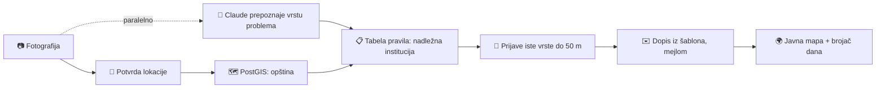

<p align="center">
  
</p>

<p align="center">
  <strong>Fotografiši problem. Fixit pronađe ko je nadležan i pošalje prijavu.</strong>
</p>

<p align="center">
  <a href="https://fixit-b73a.vercel.app">fixit-b73a.vercel.app</a>
</p>

---

Rupe na putu, otvoreni šahtovi, divlje deponije i ugašene ulične svjetiljke u Podgorici nedjeljama čekaju na rješenje. Građani obično ne znaju **ko je nadležan**, pa problem završi kao objava na Instagramu umjesto kao zvanična prijava.

**Fixit** je mobilna web aplikacija (PWA) koja tu prepreku uklanja. Građanin fotografiše problem i potvrdi lokaciju. AI prepozna o čemu se radi, tabela provjerenih pravila odredi nadležnu instituciju, a formalan dopis odlazi mejlom. Svaka prijava je na javnoj mapi, uz brojač dana od slanja, pa se vidi šta stoji neriješeno i koliko dugo.

> Fixit je napravljen na hakatonu (novembar 2026). Prva verzija pokriva samo teritoriju Glavnog grada Podgorice. Dopisi u ovom okruženju idu na testno sanduče, nikad pravim institucijama.

## Kako radi



1. **Fotografija.** Do 3 fotografije, kompresovane u pregledaču i bez EXIF podataka (i bez GPS-a iz njih).
2. **Prepoznavanje.** Claude vision vraća strukturisan JSON: vrstu problema, pouzdanost, opis, ozbiljnost i da li se na fotografiji vide lica ili tablice. Ako AI nije siguran ili ne odgovori za 15 s, građanin sam bira vrstu.
3. **Nadležnost.** Određuje je **isključivo** tabela `jurisdiction_rules` za par (vrsta, opština). Svako pravilo ima izvor i datum provjere. AI nikad ne bira primaoca. Kad pravilo ne postoji, prijava ide administratoru, koji instituciju bira ručno.
4. **Duplikati.** Ako u krugu od 50 m već postoji otvorena prijava iste vrste, građanin je može podržati umjesto da pravi novu.
5. **Slanje.** Dopis nastaje iz fiksnog šablona, a AI piše samo opis onoga što se vidi. Građanin na jednom ekranu pregleda sve i šalje prijavu.

Srećni put od fotografije do poslate prijave traje ispod 60 sekundi i ima **2 dodira**: „Potvrdi lokaciju" i „Pošalji prijavu".

## Šta aplikacija ima

| Za koga | Šta dobija |
|---|---|
| **Građanin** | Prijava za manje od minuta, praćenje statusa, podrška tuđim prijavama („Podržavam") |
| **Svako, i bez naloga** | Javna mapa sa statusima i brojačem dana, javna stranica prijave sa vremenskom linijom, brojač podrški uživo |
| **Službenik institucije** | Panel sa prijavama svoje institucije, promjena statusa uz poruku građaninu |
| **Administrator** | Ručno raspoređivanje prijava za koje nema pravila („Proslijedi instituciji") |

Statusi prijave: `Poslata` → `Primljena` → `U radu` → `Riješena`, uz `Određuje se nadležni`, `Preusmjerava se` i `Odbijena`.

## Stack

| Sloj | Tehnologija |
|---|---|
| Aplikacija | [Next.js 16](https://nextjs.org) (App Router), React 19, TypeScript (strict) |
| UI | Tailwind CSS 4, [shadcn/ui](https://ui.shadcn.com), fontovi Overpass |
| Baza, auth, fotografije, realtime | [Supabase](https://supabase.com): Postgres + PostGIS, Auth, Storage, Realtime |
| AI | [Claude API](https://docs.anthropic.com) (`claude-haiku-5-5`), izlaz provjeren sa `zod` |
| Mejl | [Resend](https://resend.com) |
| Mapa i adrese | Leaflet + OpenStreetMap, Nominatim |
| Hosting | Vercel |
| Testovi | Vitest |

Nema posebnog backenda, reda čekanja ni Edge funkcija: sav serverski kod je u Next.js aplikaciji.

## Pokretanje

**Potrebno:** Node 24 i pnpm 12 (`corepack enable`), plus pristup zajedničkom Supabase projektu.

```bash
git clone https://github.com/vuk-01/fixit.git
cd fixit
pnpm install
cp .env.example .env.local   # popuni vrijednosti
pnpm dev
```

Aplikacija je na [http://localhost:3000](http://localhost:3000). Tok prijave se najbolje provjerava u prikazu širine 360 px, jer pregledač na `localhost`-u dozvoljava kameru i lokaciju.

### Env varijable

Imena su u [`.env.example`](.env.example), a detalji u [`Tech.md` §10](Tech.md).

| Varijabla | Napomena |
|---|---|
| `NEXT_PUBLIC_SUPABASE_URL`, `NEXT_PUBLIC_SUPABASE_PUBLISHABLE_KEY`, `NEXT_PUBLIC_SITE_URL` | Javne, zaštićene RLS-om |
| `SUPABASE_SERVICE_ROLE_KEY` | Samo server (`lib/supabase/admin.ts`) |
| `ANTHROPIC_API_KEY`, `ANTHROPIC_MODEL` | Bez ključa aplikacija radi ručnim tokom |
| `RESEND_API_KEY`, `EMAIL_MODE`, `TEST_INBOX`, `EMAIL_FROM`, `EMAIL_REPLY_TO` | `EMAIL_MODE=test` šalje sve mejlove na `TEST_INBOX` |
| `DEMO_PASSWORD` | Samo lokalno, za demo naloge |

### Komande

| Komanda | Šta radi |
|---|---|
| `pnpm dev` | Razvojni server |
| `pnpm build` / `pnpm start` | Produkcioni build i pokretanje |
| `pnpm typecheck` | Provjera tipova |
| `pnpm lint` | ESLint |
| `pnpm test` | Vitest testovi |
| `pnpm db:types` | Regeneriše TypeScript tipove iz Supabase šeme |
| `pnpm db:seed-demo` | Demo nalozi i demo prijave (može se pokrenuti više puta) |
| `pnpm db:clear-demo` | Briše demo podatke (traži potvrdu) |

## Struktura

```
app/              rute (crnogorski URL-ovi: /prijavi, /p/[code], /panel, /admin, /uloguj-se)
  api/agent/      classify (jedini poziv modela) i prepare (nadležnost, duplikati, dopis)
components/       UI: mapa, tok prijave, panel, admin, shadcn komponente
lib/
  agent/          poziv Claude-a, prompt, zod šema
  email/          send.ts (jedino mjesto slanja mejla), šablon dopisa
  geo/            reverse geocoding, transliteracija ćirilica → latinica
  supabase/       klijenti (browser, server, admin) i generisani tipovi
  constants.ts    sav tekst koji korisnik vidi, vrste problema, ograničenja
supabase/         migracije (granica Podgorice, institucije, pravila, RLS)
scripts/          seed i brisanje demo podataka
```

## Bezbjednost i privatnost

- **AI ne određuje nadležnost.** Primalac dolazi samo iz tabele pravila ili od administratora.
- **Bez slanja pravim institucijama.** Svako slanje ide kroz `lib/email/send.ts`, a sve osim `EMAIL_MODE=live` preusmjerava i primaoca i kopiju na testno sanduče.
- **RLS na svakoj tabeli.** Klijent nikad ne piše status direktno; prelaze sprovode RPC funkcije u bazi.
- **Tajne samo na serveru.** Nijedan ključ nema prefiks `NEXT_PUBLIC_`.
- **Privatnost građana.** Javnost ne vidi ko je prijavio ni ko je podržao prijavu. Fotografije su u privatnom bucket-u, bez EXIF-a, a lica i tablice AI označava za moderaciju.
- **Tekst sa fotografije je podatak, nikad instrukcija.** Prompt to izričito traži, a model prijavljuje kad tekst na fotografiji pokušava da da uputstvo.

## Dokumentacija

| Dokument | Sadržaj |
|---|---|
| [`PRD.md`](PRD.md) | Šta gradimo: uloge, funkcije, zahtjevi, stranice |
| [`Tech.md`](Tech.md) | Kako: stack, verzije, agent tok, env varijable, komande |
| [`DB.md`](DB.md) | Šema, RPC funkcije, RLS, storage, demo podaci |
| [`UI.md`](UI.md) | Fixit dizajn: boje, tipografija, komponente |
| [`GLOSSARY.md`](GLOSSARY.md) | Pojmovi u UI-ju i njihovi nazivi u kodu |
| [`AGENTS.md`](AGENTS.md) | Pravila rada, za ljude i za AI agente |

## Tim

Fixit su na hakatonu napravili Ivana, Danijela i Vuk.
